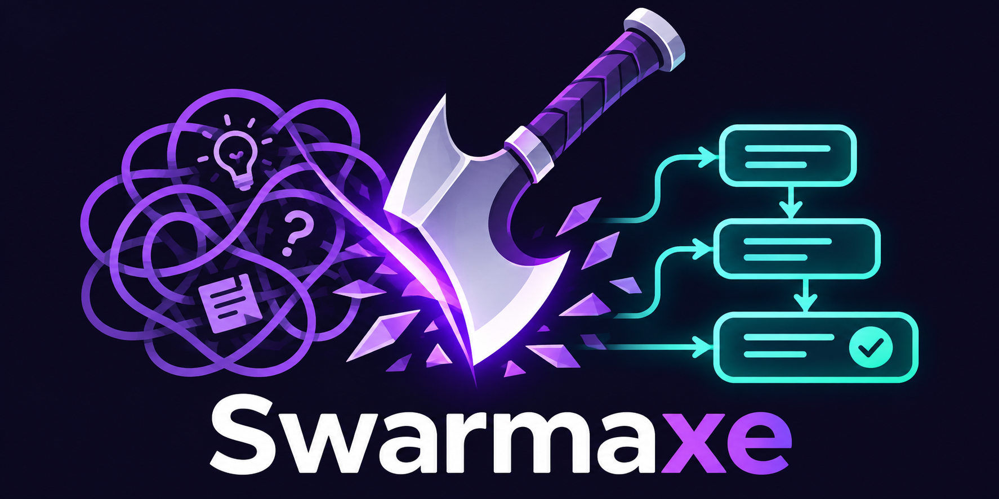
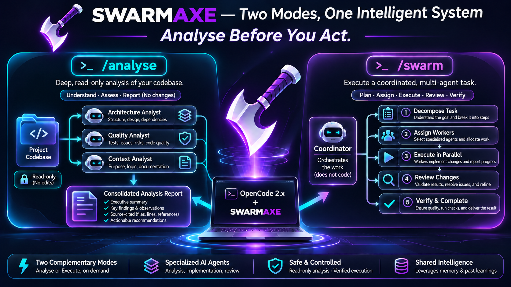
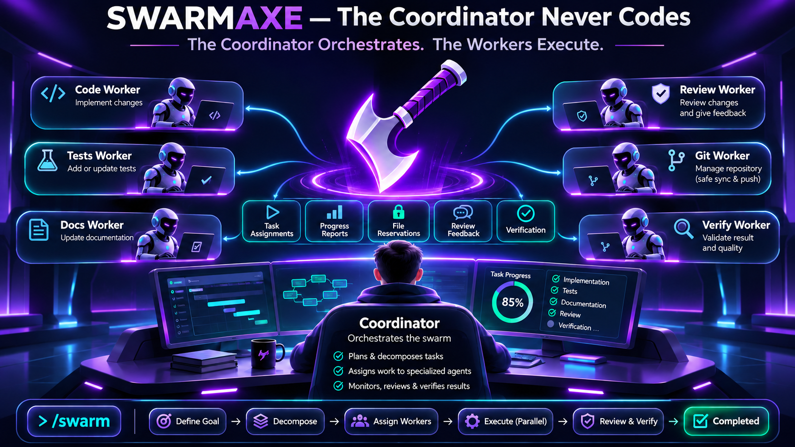

<p align="center">
  
</p>

**Multi-agent swarms for OpenCode 2.x: 92 tools, in-process execution, persistent memory.**

swarmaxe runs multi-agent swarms inside OpenCode. It registers 92 tools, routes
each call to the cheapest safe execution path, keeps project memory in a single
local SQLite database, and ships a doctor that proves the whole pipeline works.

## How it works

### Two modes, one entry point

`/analyse` inspects a codebase without touching it: three analyst subagents
(architecture, quality, context) work read-only and return one consolidated,
source-cited report. `/swarm` executes: the coordinator decomposes the task into
cells, assigns workers, reviews and verifies the result. Both use the same
registered tool set; what differs is the agent prompts and their permissions.

### The adapter
`src/adapter/swarmaxe.ts` is an OpenCode V2 plugin
(`Plugin.define({ id: "swarmaxe" })`). V2 calls `setup(ctx)` once per opened
project. Because the V2 tool context carries no directory, each setup captures
its project path and binds its tool set to it — otherwise cells created in one
project become "Bead not found" in another. Two layers are merged:

- **74 wrapper tools** from `src/adapter/legacy.ts`, written against the V1
  plugin API (`(input) => ({ tool, hooks })`). The adapter injects the tool name,
  converts Zod raw shapes to JSON Schema, and builds a V1-compatible context for
  `execute()`.
- **18 extras and local tools** — repository inspection (`repo_structure`,
  `repo_tree`, `repo_readme`, `repo_file`), diagnostics (`swarm_diagnose`,
  `swarm_insights`, `swarm_analytics`), read-only SQL (`swarm_query`, 50 rows),
  `skill_forge` / `skill_curate`, and two compatibility shims
  (`swarm_checkpoint` → `swarm_progress`, `swarm_spawn_researcher` → a research
  brief) so older generated prompts do not dead-end on removed names.

That is **92 tools**, audited against the 117 implementations shipped in the
package bundle.

### Execution routing
Every call takes one of three paths:

- **In-process (26 tools).** Read-heavy tools plus a bounded set of writes
  (`hivemind_store`, `hive_create`/`update`/`start`/`close`, `swarm_progress`,
  `swarmmail_*`) run against the package's own `SwarmPlugin` factory, imported
  once and reused. Per-call cap 300 s, import cap 20 s.
  `SWARM_INPROC=0` disables this path.
- **CLI.** Everything else spawns `swarm tool <name> --json` with
  `OPENCODE_SESSION_ID`, `OPENCODE_MESSAGE_ID`, `OPENCODE_AGENT` and
  `SWARM_PROJECT_DIR` in the environment, a `PATH` that includes `~/.bun/bin`
  and the project's `node_modules/.bin`, and `GIT_TERMINAL_PROMPT=0` so an
  unauthenticated `git push` fails instead of hanging. Timeout 180 s, killed
  with `SIGKILL`.
- **Heavy CLI (900 s).** `swarm_complete`, `swarm_review`, `swarm_verify`,
  `swarm_decompose`, the prompt builders, `skills_execute`, `hivemind_index`,
  `cass_index` and `hivemind_sync` run `tsc`/`bun test` or full re-embeddings,
  and stay off the plugin event loop.

If the bundle cannot be loaded, the in-process path degrades to the CLI
automatically. Retries (4 attempts, 0.5 s → 8 s) apply only to
`SQLITE_BUSY`/`database is locked`, never to a write that already executed.

### One database, real concurrency
Cells, memories, reservations and mail share one SQLite file
(`~/.config/swarm-tools/swarm.db`). The installer patches the package's
connection open path:

- `wal_checkpoint(TRUNCATE)` → `PASSIVE`, so opening a connection no longer
  takes an exclusive lock;
- the `PRAGMA auto_vacuum` replay is removed — a persistent setting that
  demanded a write lock on every call;
- `busy_timeout` 5 s → 15 s, so a waiter can outlast a writer;
- adapter retries span ~18 s cumulative, longer than the timeout they wait on.

### Memory pipeline
`scripts/index-sessions.py` reads OpenCode's own database
(`~/.local/share/opencode/opencode.db`) read-only, condenses each settled session
into 1–3 JSONL records, redacts secrets (`sk-`, `ghp_`, `AKIA`, private keys,
`password=`), and writes chunks of at most 3,000 characters under
`~/.opencode/session-history/`. `hivemind_index` picks them up, embeds them with
Ollama (`/api/embed`, `num_ctx` 4096, source chunks capped at 6,000 characters),
and serves them through `hivemind_find` and `cass_search`. Indexing is
incremental and idempotent: chunk ids are `<session_id>-<n>`, inserts are
upserts, and an existing chunk is skipped unless its content changed.

### Skill Forge
`src/lib/skill-forge.ts` validates generated skills before anything is written:
kebab-case names, 20–200 character descriptions, a mandatory "When NOT to use"
section, executable verification, duplicate detection, seven secret patterns,
script syntax checks and a 20 KB body cap. `commit: false` is the default, so
the tool renders and validates while the agent decides; `skill_curate` proposes
drafts from recurring memory tags and never writes.

### Coordination

The coordinator plans and decomposes, then specialist roles execute: code,
tests, docs, review, git and verification. Workers reserve the files they touch,
so parallel edits do not collide; progress events land in cells; review feedback
can send work back; `swarm_verify` runs the project's typecheck and tests before
completion. The coordinator never edits files itself.

### Verification
- `./verify.sh` — tool-coverage audit (every declared tool has an
  implementation), Skill Forge tests, `node --check` on the TypeScript,
  `py_compile` and `bash -n` on the scripts. No network.
- `scripts/swarmaxe-doctor.sh` — 30+ live checks: package patches applied,
  adapter loaded, in-process path alive, orphan processes, Ollama and embedding
  dimensions, database `quick_check`, live tool calls, and a memory
  store/find/remove round-trip.
- Ops jobs — watchdog every 15 minutes, session indexer twice a day, weekly
  coherent backups (launchd or cron).

## Performance

Measured on a 2019-era Intel Mac with 1,200+ memories loaded.

| Scenario | Result |
|---|---|
| In-process tool call, steady state | **p50 2–5 ms** |
| Single `hive_cells` call | **4–25 ms** |
| 24 sequential tool calls | **177 ms** (p50 4 ms) |
| 8 parallel tool calls | **41 ms** |

p50 = median per call. The tool bundle is imported once, the SQLite connection is
reused, and tool definitions are built once per project. Heavy tools run through
the CLI so they never block the event loop.

## Install

```bash
git clone https://github.com/achhhx10/swarmaxe.git
cd swarmaxe
./install.sh            # --dry-run, --no-launchd, --no-verify
```

Requirements: macOS or Linux, Node ≥ 20, Bun, Python 3.9+, OpenCode 2.x.

## Verify

Without installing (repo only):

```bash
./verify.sh
```

Once installed:

```bash
~/.config/opencode/patches/swarmaxe-doctor.sh
```

Expect `resultat: NN OK, 0 FAIL`. The doctor is load-aware: during an index run,
latency checks become notes instead of false failures.

## Design

- **Dependency, not a fork.** `opencode-swarm-plugin` is installed at setup time
  and patched in place, with backups and idempotent, version-specific scripts.
  Nothing else is vendored.
- **Fast path, safe fallback.** In-process execution is allowlisted. If the
  bundle cannot be loaded, every tool falls back to the CLI automatically.
- **No silent behaviour.** Every degradation is logged in
  `~/.config/swarm-tools/logs/` and reported by the doctor.

## Limits

- Tool names (`swarm_*`, `hive_*`, `hivemind_*`) are a contract used by generated
  prompts and the CLI; they are never renamed.
- No credentials, databases or logs are shipped.
- Skills are never generated without validation — see `docs/ARCHITECTURE.md`.

## Licence

MIT. See `LICENSE`.
